# BillBox

**Read GST bills on your own computer with an open-weight AI model, verify every number with plain code, and export a clean Excel file for your CA.**

BillBox turns a pile of photographed bills and PDF invoices into a reviewed, colour-coded spreadsheet. A local vision model reads each bill, deterministic rules check the result, and anything doubtful is flagged for a human instead of slipping into a tax filing. Nothing is uploaded to any cloud.

> Built for the Hacktoberfest Open-Source AI Challenge (Week 2: Side Hustle).

---

## Table of contents

1. [The problem and who pays for the fix](#1-the-problem-and-who-pays-for-the-fix)
2. [GST in 60 seconds](#2-gst-in-60-seconds)
3. [How it works (workflow)](#3-how-it-works-workflow)
4. [The core idea: AI reads, code decides](#4-the-core-idea-ai-reads-code-decides)
5. [What every field means](#5-what-every-field-means)
6. [The checks, one by one](#6-the-checks-one-by-one)
7. [Project structure: what every file is for](#7-project-structure-what-every-file-is-for)
8. [The Excel output](#8-the-excel-output)
9. [Privacy and data handling](#9-privacy-and-data-handling)
10. [Install and run](#10-install-and-run)
11. [Measuring accuracy](#11-measuring-accuracy)
12. [Tests](#12-tests)
13. [Configuration](#13-configuration)
14. [Tech stack and why](#14-tech-stack-and-why)
15. [API reference](#15-api-reference)
16. [Troubleshooting](#16-troubleshooting)
17. [Honest limitations](#17-honest-limitations)
18. [Roadmap](#18-roadmap)
19. [License](#19-license)

---

## 1. The problem and who pays for the fix

Small shops, freelancers and their accountants in India collect GST bills as phone photos, WhatsApp images and emailed PDFs. Before each GST filing, someone retypes them into Excel by hand. It is slow, boring, and a single misread digit can mean a wrong claim.

| Who | Pain | What BillBox gives them |
|---|---|---|
| Chartered accountants and bookkeepers handling 20-100 small clients | Hours of retyping every month-end | A reviewed spreadsheet per client in minutes |
| Small shop owners and freelancers | Paying for data entry, or doing it late | Self-serve bill reading, no accountant needed for the typing |
| Anyone who values privacy | Bills contain GSTINs, client names and amounts | Everything stays on their own machine |

**Business model (the "side hustle"):** a flat monthly fee for individuals, or a per-batch fee for accountants who process many clients.

## 2. GST in 60 seconds

You do not need to be an accountant to follow this project, but these terms appear everywhere:

- **GST** - India's Goods and Services Tax, added to most bills.
- **GSTIN** - a business's 15-character GST registration number, e.g. `27GOBOY6505B4ZU`. The first 2 digits are the state, the next 10 are the business's PAN, and the **last character is a checksum**. That checksum is what lets BillBox catch misread characters.
- **CGST + SGST** - the two halves of GST charged when buyer and seller are in the **same state**. They are always equal.
- **IGST** - GST charged instead when buyer and seller are in **different states**.
- **Taxable value** - the amount before tax. **Total** = taxable value + taxes.
- **Input tax credit (ITC)** - a business can claim back GST it paid on purchases, but only with a valid supplier GSTIN on the bill. This is why a missing or misread vendor GSTIN matters.

## 3. How it works (workflow)

```mermaid
flowchart LR
    A["Bill photo or PDF"] --> B["Drag and drop in the browser"]
    B --> C["Server saves it to a temp folder"]
    C --> D["Prepare image<br/>fix rotation, resize, split PDF pages"]
    D --> E["Local vision model (Ollama)<br/>reads fields as structured JSON"]
    E --> F{"Vendor GSTIN<br/>missing or invalid?"}
    F -- yes --> G["Second read: list all GSTINs,<br/>pick the seller by label"]
    F -- no --> H
    G --> H["Clean and repair<br/>dates, numbers, look-alike characters"]
    H --> I["Validators<br/>checksum, tax maths, duplicates"]
    I --> J["Status per bill<br/>OK / CHECK / REVIEW"]
    J --> K["Review table in the browser<br/>edit any cell, re-checked instantly"]
    K --> L["Download Excel<br/>colour-coded, with live formulas"]
    C -. "temp file deleted after reading" .-> M[("Nothing kept on the server")]
```



**Step by step**

1. **Upload.** You drop images or PDFs on the page. Files are sent to the server one at a time so you see live progress.
2. **Prepare.** Photos are rotated using their EXIF data and shrunk to at most 1600 px so a laptop can handle them. PDFs are rendered to images, one per page, and each page is treated as its own bill.
3. **Read.** The image goes to a local open-weight vision model through Ollama. The model must answer in a fixed JSON shape (a schema), at temperature 0 for repeatable output.
4. **Second read (only if needed).** Bills often show two GSTINs, and a small model sometimes drops the seller's or reads it wrongly. If the vendor GSTIN is missing or fails validation, BillBox asks the model a narrower question: "list every GSTIN with its label". Code then picks the seller's by label, rules out the buyer's, and prefers one that passes the checksum. The re-read replaces the original only if it is valid (or the original was empty), so one bad value is never swapped for another.
5. **Clean and repair.** Dates are converted to `YYYY-MM-DD` (day-first, as Indian bills are written), numbers are normalised, and look-alike character mistakes in GSTINs are repaired only when the checksum proves the fix.
6. **Validate.** Every bill goes through the checks in [section 6](#6-the-checks-one-by-one) and gets a status.
7. **Review.** In the browser you see every bill with problem cells highlighted. Edit any value and the whole list is re-checked immediately, including cross-file duplicate detection.
8. **Export.** One click downloads an Excel file, with doubtful rows coloured and formulas that recompute totals.

## 4. The core idea: AI reads, code decides

Vision models are good at reading messy photos but occasionally misread a digit, and in tax work a wrong number is expensive. So the work is split on purpose:

```
        AI model                         Plain code
   ┌──────────────────┐            ┌──────────────────────┐
   │ Reads the bill   │  ───────►  │ Decides whether to   │
   │ (fuzzy, flexible)│            │ trust what was read  │
   └──────────────────┘            │ (strict, repeatable) │
                                   └──────────────────────┘
```

A single wrong character usually breaks the GSTIN checksum or the tax arithmetic, so the error is caught and flagged instead of being silently accepted. The model never gets the final say on whether a bill is correct.

## 5. What every field means

Each bill is reduced to the fields below. "Read by" says who produces the value; "Checked by" says what protects it.

| Field | What it is | Example | Read by | Checked by |
|---|---|---|---|---|
| `vendor_name` | Seller's business name | `VERMA PRINTING PRESS` | AI | Human review (not validated) |
| `vendor_gstin` | Seller's GSTIN | `27GOBOY6505B4ZU` | AI, second read if empty or invalid, auto-repair | Format and checksum |
| `buyer_gstin` | Customer's GSTIN (blank for unregistered buyers) | `23IDQBN3050N7ZO` | AI, auto-repair | Format, checksum, state vs tax type |
| `invoice_number` | Bill number | `INV/554/26` | AI | Missing is a warning; used for duplicate detection |
| `invoice_date` | Bill date, stored as ISO | `2026-06-14` | AI, then parsed by code | Must parse as a real date |
| `taxable_value` | Amount before tax | `2426.65` | AI | Tax arithmetic |
| `cgst` / `sgst` | Central and state GST (same-state bills) | `0.00` | AI | Must be equal; not mixed with IGST |
| `igst` | Integrated GST (inter-state bills) | `291.20` | AI | Not mixed with CGST/SGST |
| `cess` | Extra levy on some goods | `0.00` | AI | Included in the total check |
| `total` | Final payable amount | `2717.85` | AI | Must equal taxable + taxes (within Rs 1) |
| `summary` | One-line description of what the bill is for | `Printing of visiting cards` | AI | Not verified by code |
| `category` | Expense category from a fixed list | `Stationery & printing` | AI (constrained to the list) | Not verified by code |

Added by BillBox itself:

| Field | What it is |
|---|---|
| `source` | The file the bill came from (with page number for multi-page PDFs) |
| `status` | `OK`, `CHECK` or `REVIEW` (see below) |
| `flags` | The list of notes explaining the status: errors, warnings and info |

**Categories:** Stationery & printing, Electronics & IT, Hardware & tools, Medical & pharmacy, Food & beverages, Travel & fuel, Rent & utilities, Repairs & maintenance, Professional services, Raw material & stock, Clothing & textiles, Other.

**Statuses**

| Status | Meaning | What you do |
|---|---|---|
| `OK` | Passed every check | Nothing |
| `CHECK` | Has a warning, such as a missing vendor GSTIN or an unusual tax rate | Glance at it once |
| `REVIEW` | Has an error, such as a wrong total or an invalid GSTIN | Fix it before filing |

Blue **info** notes (for example "Vendor GSTIN auto-corrected ... checksum confirms the fix") record what the code repaired. They never change the status and exist so every automatic change is visible.

## 6. The checks, one by one

| Check | Why it matters | Result if it fails |
|---|---|---|
| Vendor GSTIN present | Needed to claim input tax credit | Warning |
| Vendor GSTIN format and checksum | A misread character almost always breaks the checksum | Error |
| Buyer GSTIN format and checksum (if present) | Same reason | Error |
| Date present and parseable | Needed for the correct filing period | Error |
| Invoice number present | Needed to identify and de-duplicate the bill | Warning |
| Total present and above zero | A bill must have an amount | Error |
| Taxable + all taxes equals total (within Rs 1) | Catches misread digits and invented taxes; Rs 1 allows for round-off | Error |
| CGST equals SGST | They are always two equal halves | Error |
| IGST not combined with CGST/SGST | A bill uses one scheme or the other | Error |
| Effective tax rate is a standard slab (0, 0.25, 3, 5, 12, 18, 28, 40 %) | An odd rate usually means a misread amount | Warning |
| Same-state parties use CGST+SGST; different-state parties use IGST | Tax type must match the states in the two GSTINs | Warning |
| Duplicate bill (same vendor and invoice number, or same vendor, date and total) | Prevents claiming the same bill twice, even across separate uploads | Error |

**GSTIN auto-repair.** Vision models confuse look-alikes such as `0`/`O`, `1`/`I`, `8`/`B`, `5`/`S`, `2`/`Z` and `6`/`G`. If a GSTIN fails its checksum, BillBox tries swapping exactly one such character. It accepts the result only if **exactly one** swap makes the checksum pass. If none or several work, it leaves the value alone and flags it. The code can prove a repair, but it never guesses. Bigger errors, such as an extra or missing character, are not repaired automatically; they are flagged `REVIEW` so a human fixes them.

## 7. Project structure: what every file is for

```
BillBox/
├── app.py                           Web server and API
├── billbox/
│   ├── __init__.py                  Marks the folder as a Python package (empty)
│   ├── extractor.py                 Talks to the local AI model
│   ├── validators.py                The trust layer: all checks and the GSTIN repair
│   ├── pipeline.py                  Connects the steps and assigns statuses
│   └── export.py                    Builds the Excel file
├── static/
│   └── index.html                   The whole web interface (HTML, CSS, JavaScript)
├── gen_synthetic.py                 Makes labelled fake bills for testing
├── eval.py                          Measures model accuracy on those bills
├── debug_one.py                     Shows exactly what the model says for one bill
├── tests/
│   ├── test_validators.py           Unit tests for the checks
│   └── test_pipeline_export.py      Tests for pipeline, Excel export and the API
├── data/                            Generated test bills and sample output (git-ignored)
├── Dockerfile                       Packages the web app into a container
├── docker-compose.yml               Starts BillBox plus its own Ollama
├── docker-compose.host-ollama.yml   Starts BillBox and reuses the Ollama on your PC
├── .dockerignore                    Keeps venv, .git and test data out of the container
├── DOCKER.md                        Plain-language Docker guide
├── requirements.txt                 Python dependencies
├── .gitignore                       Keeps caches, generated data and spreadsheets out of Git
├── LICENSE                          MIT license
└── README.md                        This file
```

| File | Purpose in detail |
|---|---|
| `app.py` | A FastAPI server. Serves the page, reports whether Ollama and the model are ready, processes uploads in a temp folder that is deleted afterwards, re-validates edited bills, and builds the Excel download. It holds no state. |
| `billbox/extractor.py` | Loads images (rotation fix, resize, PDF to pages), defines the JSON schema and the prompt, calls Ollama, and implements the "second read" that finds the seller's GSTIN by label. |
| `billbox/validators.py` | Pure functions with no AI and no network: GSTIN checksum and repair, date parsing, every tax check, duplicate keys. The most important file for correctness. |
| `billbox/pipeline.py` | Normalises raw model output, runs the second read when needed, attaches flags, sets `OK`/`CHECK`/`REVIEW`, and re-checks a whole list after edits (including cross-file duplicates). |
| `billbox/export.py` | Writes the Excel workbook with colour-coded rows, live formulas and a summary sheet. Column letters are looked up by name so formulas cannot drift when columns change. |
| `static/index.html` | Drag-and-drop upload with progress, summary cards, filter chips, an editable table with problem cells highlighted, notes, row delete, and a Clear all data button. No build step and no framework. |
| `gen_synthetic.py` | Draws fake GST bills with structurally valid (invented) GSTINs plus a `truth.json` of correct answers, so you can test without anyone's private data. |
| `eval.py` | Runs a model over the fake bills and prints per-field accuracy, fully correct bills, and how many wrong readings the validators caught. |
| `debug_one.py` | Prints the model's raw answers for one bill. First stop when a field comes back wrong. |
| `tests/` | 24 automated tests with the model mocked, so they run in seconds with no GPU. |
| `Dockerfile`, `docker-compose*.yml`, `.dockerignore` | Optional Docker packaging. See [DOCKER.md](DOCKER.md). |

## 8. The Excel output

**Sheet "Bills"** - one row per bill, coloured red (`REVIEW`), amber (`CHECK`) or plain (`OK`):

`Source` | `Status` | `Vendor` | `Category` | `What it's for (AI summary)` | `Vendor GSTIN` | `Buyer GSTIN` | `Invoice No` | `Date` | `Taxable` | `CGST` | `SGST` | `IGST` | `Cess` | `Total` | `Recalculated Total` | `Difference` | `Review notes`

`Recalculated Total` and `Difference` are live formulas, so a mismatch is visible even after you edit cells in Excel. Filters and a frozen header row are on by default.

**Sheet "Summary"** - bill counts by status, total taxable value, total CGST/SGST/IGST, total invoice value, and input tax from `OK` bills only (a conservative figure for what is safe to claim), plus a note on what the colours and checks mean.

## 9. Privacy and data handling

- The AI model runs **locally** through Ollama. Bills are never sent to any cloud service.
- Uploaded files are written to a temporary folder only while the model reads them, then deleted.
- The Excel file is built in a temporary folder and deleted right after download.
- The server stores nothing. Results live only in the browser tab (session storage): they survive a refresh but vanish when the tab closes.
- **Clear all data** wipes the results immediately. Each row also has a button to remove just that bill.
- Ollama keeps the model in memory for a few minutes after use, then unloads it.
- With Docker, the port is bound to `127.0.0.1`, so only the same computer can open the page.
- BillBox is a single-user local tool with no login. Run it on `localhost` only; do not expose it to a network.

## 10. Install and run

**Requirements:** Python 3.10 or newer, [Ollama](https://ollama.com), and about 4 GB of free disk for the model. A GPU helps but is not required.

```bash
# 1. Get a vision model (the first run is slow while it loads)
ollama pull gemma3:4b

# 2. Create an environment and install
python -m venv venv
venv\Scripts\activate            # Windows PowerShell: venv\Scripts\Activate.ps1
# source venv/bin/activate       # macOS / Linux
pip install -r requirements.txt

# 3. Run the tests (optional but recommended)
python -m pytest -q

# 4. Start the app
uvicorn app:app --reload
```

Open <http://localhost:8000>. The status pill at the top right should say **"Local model ready"**. Drop in a few bills.

**Try it without real bills:**

```bash
python gen_synthetic.py --n 30 --out data/synthetic
```

then drag images from `data/synthetic/` onto the page.

### Run with Docker (optional)

If you have [Docker Desktop](https://www.docker.com/products/docker-desktop), you can skip the Python setup. If you already have Ollama and `gemma3:4b` installed, reuse them:

```bash
docker compose -f docker-compose.host-ollama.yml up -d --build
```

Or run everything, including Ollama, inside Docker:

```bash
docker compose up -d --build
docker compose exec ollama ollama pull gemma3:4b
```

Then open <http://localhost:8000>. See [DOCKER.md](DOCKER.md) for a plain-language explanation, speed notes and troubleshooting.

## 11. Measuring accuracy

```bash
python gen_synthetic.py --n 30 --out data/synthetic      # labelled fake bills
python eval.py data/synthetic                            # default model
python eval.py data/synthetic --model qwen2.5vl:7b       # compare another model
python debug_one.py data/synthetic/bill_000.jpg          # inspect one bill
```

`eval.py` reports accuracy per field, how many bills were read fully correctly, and **how many wrong readings the validators flagged automatically**. That last number is the safety net's real value.

| Model | Fully correct bills | Wrong bills auto-flagged | Time per bill |
|---|---|---|---|
| gemma3:4b | _fill in after running eval_ | _fill in_ | _fill in_ |
| qwen2.5vl:7b | _fill in_ | _fill in_ | _fill in_ |

Synthetic bills are cleaner than real ones. Always test on real, anonymised bills before trusting any accuracy figure.

## 12. Tests

```bash
python -m pytest -q        # 24 tests
```

They cover the GSTIN checksum and repair, every tax check, date parsing, duplicate detection (including across separate uploads), model-offline handling, Excel export formulas, temp-file cleanup, and the API. The AI model is mocked, so the suite needs no Ollama and no GPU.

## 13. Configuration

| Environment variable | Default | Meaning |
|---|---|---|
| `BILLBOX_MODEL` | `gemma3:4b` | Any Ollama vision model, e.g. `qwen2.5vl:7b` or `llama3.2-vision` |
| `OLLAMA_URL` | `http://localhost:11434` | Where Ollama is running |

```powershell
$env:BILLBOX_MODEL="qwen2.5vl:7b"; uvicorn app:app --reload     # Windows PowerShell
```

```bash
BILLBOX_MODEL=qwen2.5vl:7b uvicorn app:app --reload             # macOS / Linux
```

## 14. Tech stack and why

| Part | Choice | Why |
|---|---|---|
| AI runtime | **Ollama** | Runs open-weight models locally with one command and a simple HTTP API |
| Model | **Gemma 3 (4B, vision)** by default | Small enough for a laptop, reads images, openly available; swappable |
| Language | **Python** | The natural home for AI and data tooling |
| Web server | **FastAPI + Uvicorn** | Small, fast, easy to read; no heavy framework |
| Frontend | **Plain HTML, CSS, JS** | No build step, so anyone can run it in seconds |
| Images | **Pillow** | Fixes phone-photo rotation and resizes for speed; draws the fake test bills |
| PDFs | **PyMuPDF** | Renders PDF pages to images for the model (only needed for PDFs) |
| Excel | **openpyxl** | Formatting plus live formulas |
| HTTP client | **requests** | Talks to Ollama |
| Testing | **pytest, httpx** | Fast tests; httpx lets tests call the app without a real server |
| Packaging | **Docker (optional)** | One-command setup without installing Python |

## 15. API reference

| Method and path | Purpose |
|---|---|
| `GET /` | The web interface |
| `GET /api/health` | Whether Ollama is reachable and the model is installed (drives the status pill) |
| `POST /api/process` | Upload one or more files (multipart). Returns the extracted and validated bills |
| `POST /api/check` | Send the full list of bills after edits. Returns them re-validated, with duplicates re-detected |
| `POST /api/export` | Send the list of bills. Returns an `.xlsx` and deletes the temp file afterwards |

## 16. Troubleshooting

| Symptom | Likely cause and fix |
|---|---|
| Red pill: "Ollama not running" | Start Ollama (system tray or `ollama serve`), then hard-refresh with `Ctrl + Shift + R` |
| Amber pill: "Model missing" | Run `ollama pull gemma3:4b` (or your chosen model) |
| First bill takes 1-3 minutes | The model is loading into memory. Later bills are faster. CPU-only machines are slower |
| Row shows "Extraction failed" | Read the message. Usually Ollama is off, the model name is wrong, or the request timed out |
| Vendor GSTIN blank or marked invalid | Run `python debug_one.py <image>` to see what the model returns, correct it by hand in the table, or try a larger model |
| `uvicorn` is not recognized | The virtual environment is not active. Re-run the activate command |
| `Fatal error in launcher` after moving the project folder | A virtual environment cannot be moved. Delete `venv`, run `python -m venv venv`, activate it, and `pip install -r requirements.txt` |
| `ModuleNotFoundError: billbox` | Run commands from the project root, the folder that contains `app.py` |
| PDF error mentioning `fitz` | `pip install pymupdf` |
| Old page after updating code | Hard-refresh with `Ctrl + Shift + R` |
| Docker: red pill with `docker-compose.host-ollama.yml` | Ollama is refusing connections from Docker. Run `setx OLLAMA_HOST 0.0.0.0`, then restart Ollama |

## 17. Honest limitations

- **A small model can misread.** BillBox is designed around that: checks catch many misreads, but not all. An error that still adds up (for example a wrong but consistent set of numbers, or a misread invoice number) can pass.
- **`summary` and `category` are AI-written and not verified by code.** They never affect a bill's status. They are labelled "AI" in the app and the Excel file.
- **No line items or HSN codes yet.** Each bill is read as a whole.
- **Handwritten and very low-quality bills** are much less reliable than printed invoices.
- **It does not decide input tax credit eligibility.** It only flags whether a vendor GSTIN was found and valid.
- **Synthetic test bills are cleaner than real ones**, so accuracy on real bills will be lower.
- Not tax advice. Have a qualified accountant review anything before filing.

## 18. Roadmap

- Fine-tune the model on real Indian bill formats and report before-and-after accuracy
- Line-item and HSN extraction
- Spend-by-category table on the Summary sheet
- Export for Tally and other accounting software
- Hindi and Hinglish bill support
- Watch a folder and process bills automatically
- Reconcile bills against the GST portal's purchase data

## 19. License

MIT. See [LICENSE](LICENSE).
